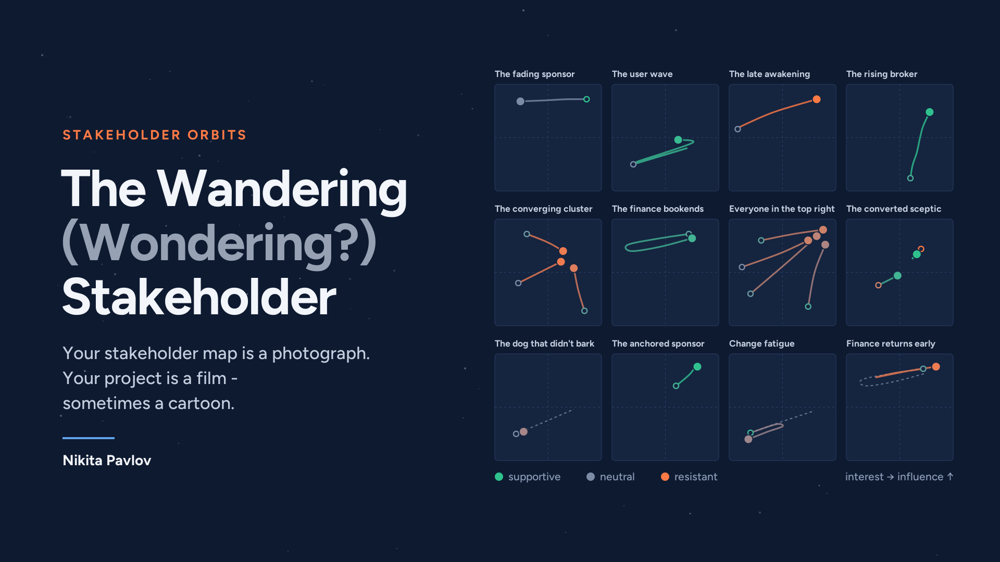
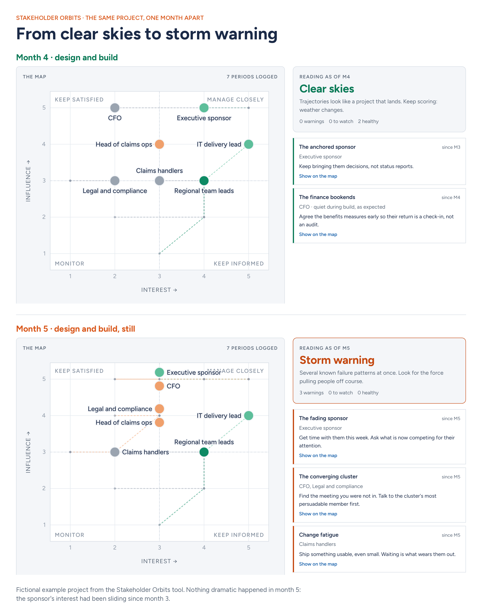
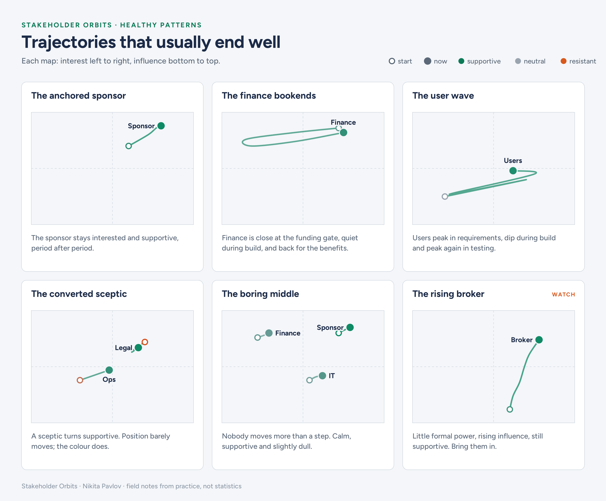
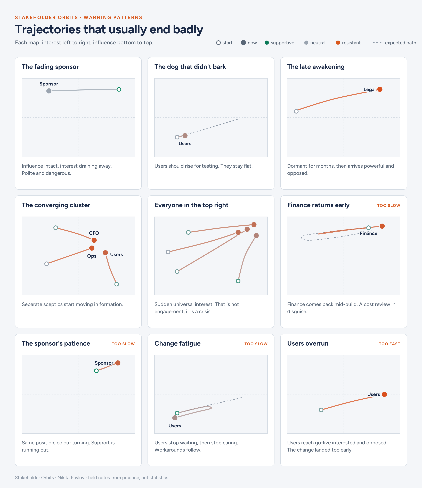

# Stakeholder Orbits

Your stakeholder map is a photograph. Your project is a film - sometimes a cartoon.

Stakeholder Orbits is a small tool for project and programme managers. You score the 8 to 12 people who can actually sink your project, once a month, in about five minutes. The tool plays back how they move across the influence and interest grid, and compares their trajectories with sixteen patterns that tend to come before success or trouble.

## Use it

**[Download page: inhabitedisland.github.io/stakeholder-orbits](https://inhabitedisland.github.io/stakeholder-orbits/)**

1. Click **Download the tool** on that page.
2. Double-click the downloaded file. It opens in your browser.

That's it. No installation, no account, no internet connection needed. It works best on a laptop or desktop. The same page also lets you try the tool in your browser before downloading.

You can also download [`stakeholder-orbits.html`](stakeholder-orbits.html) straight from this repository: open the file, then use the download button.

## Privacy

Scoring colleagues' stance is sensitive, so the tool is built to keep that data with you.

- Everything you enter stays in your own browser, on your own machine. Nothing is sent anywhere.
- The file contains a Content Security Policy that blocks the browser from making any network connection. You can check it yourself: it is the `Content-Security-Policy` line near the top of the file.
- Fonts and examples are built into the file. It makes no outside requests, even to load them.
- Clearing your browser data erases your scores. Use **Copy backup** now and then and keep the backup somewhere safe; **Restore from backup** brings it back.

## How it works

Each period (usually a month) you score every stakeholder on three things:

| Score | Scale |
| --- | --- |
| Influence | 1 to 5 |
| Interest | 1 to 5 |
| Stance | opposed, sceptical, neutral, supportive, champion |

You also tag the period with the project phase (initiation, requirements, design and build, testing, deployment, benefits), because what is normal depends on the phase. Finance should be quiet during build. Users should be loud during testing.

The tool then checks the trajectories against the pattern library and gives a reading: clear skies, quiet, unsettled or storm warning. Each finding shows when it first became visible. Click a finding to highlight the stakeholders behind it on the map.

## The patterns

| Pattern | Kind | What it means |
| --- | --- | --- |
| The anchored sponsor | Healthy | The sponsor stays interested and supportive, period after period. |
| The finance bookends | Healthy | Finance is close at the funding gate, quiet during build, back for the benefits. |
| The user wave | Healthy | Users peak in requirements, dip during build, peak again in testing. |
| The converted sceptic | Healthy | A sceptic turns supportive. Position barely moves; the colour does. |
| The boring middle | Healthy | Nobody moves more than a step. Calm, supportive, slightly dull. |
| The rising broker | Watch | Little formal power, rising influence, still supportive. Bring them in. |
| New faces at the table | Watch | Powerful newcomers join late. Each new face is usually an escalation. |
| The fading sponsor | Warning | Influence intact, interest draining away. Polite and dangerous. |
| The dog that didn't bark | Warning | Users should rise for requirements and testing. They stay flat. |
| The late awakening | Warning | Dormant for months, then arrives powerful and opposed. |
| The converging cluster | Warning | Separate sceptics start moving in formation. |
| Everyone in the top right | Warning | Sudden universal interest. Not engagement: a crisis. |
| Finance returns early | Warning (too slow) | Finance comes back mid-build. A cost review in disguise. |
| The sponsor's patience | Warning (too slow) | Same position, colour turning. Support is running out. |
| Change fatigue | Warning (too slow) | Users stop waiting, then stop caring. Workarounds follow. |
| Users overrun | Warning (too fast) | Users reach go-live interested and opposed. The change landed too early. |

The patterns are field notes from practice, not statistics. The detection thresholds are reasonable starting points, not validated science. If you recognise a pattern that is missing, or a threshold that fires too easily, open an issue.

## Background

- Mendelow, A. L. (1981). [Environmental scanning: the impact of the stakeholder concept](https://aisel.aisnet.org/icis1981/20). ICIS 1981 Proceedings. The origin of the power/interest grid.
- Mitchell, R. K., Agle, B. R. and Wood, D. J. (1997). [Toward a theory of stakeholder identification and salience](https://www.jstor.org/stable/259247). Academy of Management Review, 22(4), 853-886.
- ElWakeel, O. and Andersen, B. (2020). [Stakeholder evolution: a study of stakeholder dynamics in 12 Norwegian projects](https://doi.org/10.1108/IJMPB-10-2018-0218). International Journal of Managing Projects in Business, 13(1), 172-196.

## Author

Developed by [Nikita Pavlov](https://www.linkedin.com/in/nikita-s-pavlov/), a programme manager who got tired of stakeholder maps that never move.
